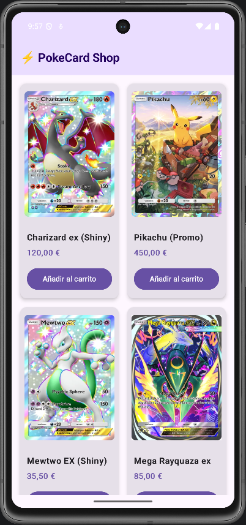
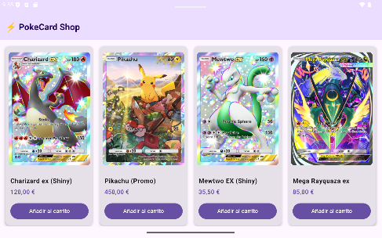

# Reto 2 · E-Commerce Adaptativo (Responsive UI)

**Módulo:** 0489 · Programación Multimedia y Dispositivos Móviles
**Autor:** Nolan Martínez Gómez
**Tecnología:** Kotlin + Jetpack Compose (Android nativo)
**RA vinculado:** RA1 y RA2 · Interfaces adaptables y limitaciones del dispositivo

## 📱 Producto Final (Capturas)
*(Borra este texto y añade debajo dos capturas de pantalla de tu aplicación funcionando: una en el emulador de MÓVIL en vertical, y otra en el emulador de TABLET o móvil en horizontal, demostrando que la cuadrícula se adapta).*

*(Guarda tus capturas en la carpeta `img/capturas/` y enlázalas así: ``).*

### Esquema de referencia
Así debería comportarse tu cuadrícula: mismas tarjetas, mismo código, más columnas cuando hay más espacio.

## 🎯 Objetivo del reto
Comprender la fragmentación de pantallas en Android y resolver los problemas de visualización en distintos perfiles de dispositivos. Pasar de un diseño estático (una lista infinita que se deforma) a una interfaz *responsive* (una cuadrícula inteligente) utilizando componentes de Jetpack Compose que calculan el espacio disponible en tiempo real.

## 🛠️ Componentes y conceptos utilizados

| Componente / Concepto | Para qué se usa en esta app |
| :--- | :--- |
| **LazyVerticalGrid** | Sustituye a `LazyColumn` para crear una cuadrícula dinámicamente optimizada en rendimiento. |
| **GridCells.Adaptive** | Calcula automáticamente el número de columnas según el espacio disponible, fijando un ancho mínimo de `180.dp`. |
| **Card & CardDefaults** | Crea un contenedor elevado (`4.dp`) con bordes redondeados para agrupar de forma limpia la imagen y los datos del producto. |
| **aspectRatio & ContentScale.Fit** | Mantiene la relación de aspecto vertical original (0.7f) de las cartas de colección sin cortarlas ni deformarlas. |
| **Scaffold & TopAppBar** | Proporciona la estructura estándar de interfaz en Material Design 3 con barra superior de título. |
| **LaunchedEffect & CircularProgressIndicator** | Simula un estado asíncrono de carga de datos mostrando un spinner interactivo. |
| **SnackbarHost** | Muestra mensajes flotantes de confirmación cuando el usuario pulsa "Añadir al carrito". |
| **maxLines & TextOverflow** | Fuerza a que los nombres largos ocupen una sola línea y añade puntos suspensivos (`...`) para evitar descuadres. |

## 🧐 Reflexión y Pensamiento Crítico

1. **Sobre la adaptabilidad:** ¿Por qué hemos usado `GridCells.Adaptive(minSize = ...)` en lugar de fijar el número de columnas con `GridCells.Fixed(2)`? ¿Qué ventaja tiene en el mundo real?
   > Usar `GridCells.Adaptive` permite que la interfaz sea verdaderamente multi-dispositivo. Con `GridCells.Fixed(2)` forzaríamos 2 columnas tanto en un móvil pequeño de 5" como en una tablet de 12", haciendo que en la tablet las tarjetas se vieran gigantescas y desproporcionadas. `Adaptive` calcula en tiempo real cuántas tarjetas de al menos `180.dp` caben, mostrando 1 o 2 columnas en móviles y 3 o más en tablets de forma automática.

2. **Sobre el diseño UI:** ¿Qué ocurría con las tarjetas si el nombre de un producto era muy largo y ocupaba dos líneas mientras los demás ocupaban una? ¿Cómo lo hemos solucionado?
   > Las tarjetas se desalineaban visualmente, ya que unas tenían más altura vertical que otras. Lo solucionamos aplicando `maxLines = 1` y `overflow = TextOverflow.Ellipsis` al componente `Text`. De este modo, si un nombre no cabe, añade automáticamente tres puntos (`...`) manteniendo todas las tarjetas alineadas y con el mismo tamaño.

3. **Sobre las imágenes:** ¿Por qué es importante ajustar el escalado y la proporción en las imágenes de los productos?
   > Las cartas coleccionables tienen una proporción vertical fija. Si usábamos `ContentScale.Crop`, la imagen se recortaba por arriba y por abajo perdiendo información clave de la carta. Al combinar `ContentScale.Fit` con un contenedor que usa `aspectRatio(0.7f)`, logramos que la imagen se adapte perfectamente al marco disponible sin deformarse ni perder partes.

4. **Visión de futuro:** Ahora mismo nuestros productos están escritos directamente en el código (*hardcodeados*). ¿Qué crees que necesitaría nuestra app en el futuro para que esta tienda mostrara productos reales de internet?
   > Necesitaría integrar una arquitectura cliente-servidor mediante un patrón MVVM (Model-View-ViewModel). Se necesitaría una librería HTTP como **Retrofit** o **Ktor** para consumir un API REST / JSON remoto, **Corrutinas** para llamadas asíncronas y **Coil** para la carga dinámica y almacenamiento en caché de imágenes desde URLs.

## 🚀 Cómo ejecutar el proyecto
1. Clonar el repositorio y abrir en Android Studio.
2. Ejecutar (▶) primero en un emulador de móvil (ej. Pixel 6).
3. Girar la pantalla del móvil a horizontal o ejecutar en un emulador de Tablet para comprobar la adaptación de la cuadrícula.

## 🐞 Dificultades y cómo las resolví
- **Corte en las imágenes de las cartas:** Al usar inicialmente `ContentScale.Crop` en la imagen dentro de una altura fija, las cartas de Pokémon se cortaban perdiendo la parte superior e inferior. Lo solucionamos implementando `ContentScale.Fit` en combinación con un `Box` con `aspectRatio(0.7f)` para mantener las proporciones exactas de una carta coleccionable.